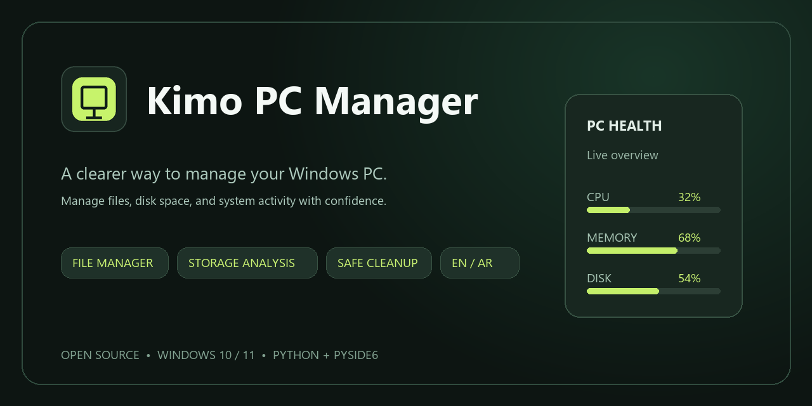

# Kimo PC Manager

[](https://github.com/qkraim723-code/kimo-pc-manager/actions/workflows/build_and_test.yml)
[](https://github.com/qkraim723-code/kimo-pc-manager/releases/latest)
[](LICENSE)


<p align="center"></p>

[English](#english) | [العربية](#العربية) | [Separate Arabic README](README_AR.md)

## English

A Windows desktop utility for managing files, understanding disk usage, reviewing temporary files, and monitoring system activity from one bilingual interface.

[English](README.md) | [العربية](README_AR.md)

## What it does

- **File Manager:** browse, organize, and move files from one window; deleted files go to the Recycle Bin where supported.
- **Storage Analysis:** see which folders and files use the most space, so you know where disk capacity is going.
- **Safe Cleanup:** review supported temporary-file categories and their sizes before deciding whether cleanup is useful.
- **Duplicate Finder:** locate byte-identical files and estimate reclaimable space while protecting one copy in each group.
- **Performance Monitor:** check CPU, memory, disk activity, and running processes to help identify current resource use. Ending a process may lose unsaved work.
- **Windows Tools:** open selected built-in utilities without searching through Windows menus.
- **Support settings:** copy the displayed support details, open the Telegram group, and control the optional startup advertisement.

## Languages

The interface is available in **English and Arabic**. English is selected by default; Arabic uses a right-to-left layout. Change the language in Settings.

## Download the app

Open the repository's **Releases** page and download the latest Windows x64 package when a release is published. Extract the complete package and run `KimoPCManager.exe`; this is an *onedir* package, so do not move the executable out of its accompanying files. Windows may ask for administrator approval when launching the packaged app.

If there is no release yet, build the package from source using the steps below.

## Run from source

Requirements: Windows 10 or 11 (64-bit) and Python 3.11 or newer.

```powershell
git clone https://github.com/<owner>/<repository>.git
cd <repository>
python -m pip install -r requirements.txt
python main.py
```

Replace `<owner>` and `<repository>` with the GitHub account and repository name. You can also run `run.bat` from the project folder.

## Build a Windows package

From the project folder, run:

```powershell
build.bat
```

The build uses PyInstaller and creates the app at `dist/KimoPCManager-Verified/KimoPCManager/KimoPCManager.exe`. Keep the full `KimoPCManager` folder together when sharing the app. The build also creates a shortcut in the project folder and on the Windows Desktop.

## Run checks

```powershell
python -m pytest -q
```

## Privacy and safety

- The app does not include analytics or usage telemetry.
- File cleanup and deletion actions are shown in the app before they are applied; ordinary file deletion uses the Windows Recycle Bin where supported.
- The optional startup advertisement is enabled by default. When enabled, the app opens its configured advertisement link in the default web browser at startup. Turn it off in **Settings → Support & Ads**. The browser then connects to that external website under its own privacy policy.
- The packaged Windows executable requests administrator approval through Windows. Running `python main.py` from source does not automatically elevate the Python process.

## Source code and contributions

The Python source is organized into `core/` (system and file services), `ui/` (the interface), `locales/` (English and Arabic text), and `tests/` (automated checks). Bug reports and focused improvements are welcome through GitHub Issues and Pull Requests.

## License

Released under the [MIT License](LICENSE).

---

## العربية

**Kimo PC Manager** تطبيق سطح مكتب لنظام Windows يجمع أدوات إدارة الملفات والتخزين ومراقبة الأداء في مكان واحد، بواجهة تدعم العربية والإنجليزية.

### ماذا تستفيد من التطبيق؟

- **مدير الملفات:** استعرض ملفاتك ونظمها وانقلها من نافذة واحدة؛ والملفات المحذوفة تنتقل إلى سلة محذوفات ويندوز متى كان ذلك مدعوماً.
- **تحليل التخزين:** اعرف المجلدات والملفات التي تستهلك أكبر مساحة لتحدد أين تذهب سعة القرص.
- **التنظيف الآمن:** راجع أنواع الملفات المؤقتة وأحجامها قبل أن تقرر إن كان حذفها سيوفر مساحة مفيدة.
- **البحث عن المكررات:** اعثر على الملفات المتطابقة وقدّر المساحة التي يمكن استعادتها، مع حماية نسخة واحدة من كل مجموعة.
- **مراقبة الأداء:** راجع استهلاك المعالج والذاكرة والقرص والعمليات لمعرفة استخدام الموارد حالياً. إنهاء عملية قد يفقدك عملاً غير محفوظ.
- **أدوات ويندوز:** افتح مجموعة من الأدوات المدمجة دون البحث عنها يدوياً في قوائم النظام.
- **اللغات:** الإنجليزية هي الافتراضية، ويمكن التبديل إلى العربية كاملة بتخطيط من اليمين إلى اليسار.

### التنزيل والتشغيل

حمّل أحدث إصدار **Windows x64** من [صفحة الإصدارات](https://github.com/qkraim723-code/kimo-pc-manager/releases/latest)، وفك ضغط الحزمة كاملة ثم شغّل `KimoPCManager.exe`. لا تنقل الملف التنفيذي وحده خارج مجلده. إذا لم يظهر إصدار للتنزيل بعد، اتبع تعليمات البناء أدناه.

لتشغيل السورس تحتاج Windows 10 أو 11 (64 بت) وPython 3.11 أو أحدث:

```powershell
python -m pip install -r requirements.txt
python main.py
```

لبناء نسخة Windows، شغّل `build.bat` من مجلد المشروع. ستجدها في `dist/KimoPCManager-Verified/KimoPCManager/`.

### الخصوصية والترخيص

لا يحتوي التطبيق على تحليلات أو تتبع للاستخدام. إعلان بدء التشغيل الاختياري مفعّل افتراضياً ويفتح رابطاً خارجياً في المتصفح؛ يمكن إيقافه من **الإعدادات ← الدعم والإعلانات**. المشروع مرخص بموجب [MIT](LICENSE).
